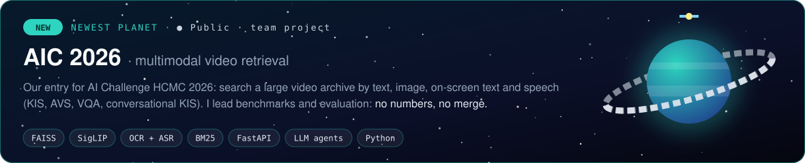
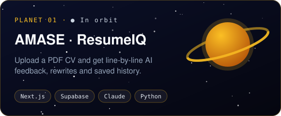
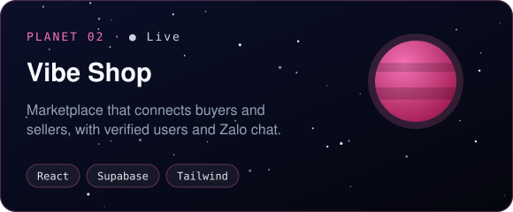
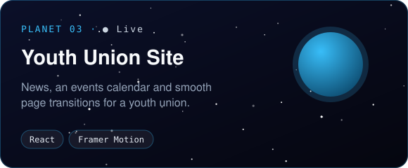
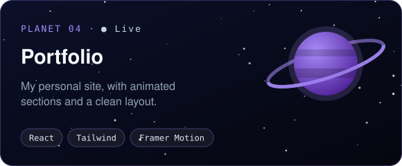
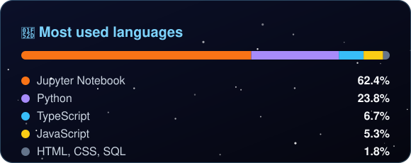
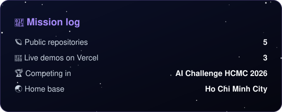

<h3 align="center">🛸 Technologies and Tools 🛸</h3>

  
  
  
  
  
  
  
   
  
  
  
  
  
  
  

<h3 align="center">🪐 Planets I've built 🪐</h3>

  

  
  
  
  

<h3 align="center">🔥 GitHub Stats 🔥</h3>

  
  

  <picture>
    <source media="(prefers-color-scheme: dark)" srcset="https://raw.githubusercontent.com/dungnguyen02102007-commits/dungnguyen02102007-commits/output/github-snake-dark.svg" />
    <source media="(prefers-color-scheme: light)" srcset="https://raw.githubusercontent.com/dungnguyen02102007-commits/dungnguyen02102007-commits/output/github-snake.svg" />
    
  </picture>

<h3 align="center">📡 Where to find me 📡</h3>

  
  &nbsp;
  

